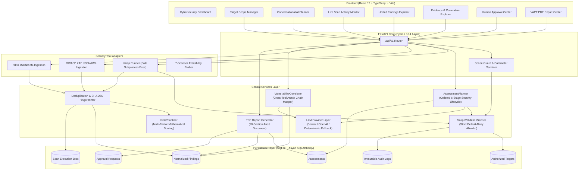
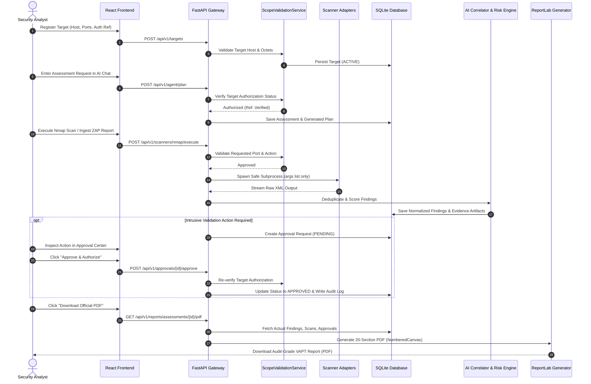

# AI-VAPT AGENT — System Architecture & Technical Specification

> **AI-Powered Unified Vulnerability Assessment and Penetration Testing Platform**  
> *Defensive AI Security Governance • Strict Scope Enforcement • Human-in-the-Loop Approval*

---

## 1. Architectural Overview

**AI-VAPT AGENT** is an enterprise-grade cybersecurity platform that unifies conversational AI planning, multi-scanner orchestration, evidence-based vulnerability intelligence, and strict scope governance into a cohesive, auditable system.

The platform is designed around three non-negotiable security principles:
1. **Strict Default-Deny Scope Policy**: The agent and all scanner adapters are physically and programmatically constrained to execute strictly against explicitly registered, actively authorized targets.
2. **Zero Autonomous Exploitation**: Dangerous exploit frameworks (e.g. Metasploit) and intrusive payloads require explicit human authorization through a dedicated approval gate.
3. **Evidence Integrity & Non-Fabrication**: CVEs, CWEs, and CVSS scores are never fabricated by AI models; all findings are backed by immutable scanner evidence artifacts.

---

## 2. Component Specifications

### 2.1 Frontend Architecture
- **Framework**: React 19 with TypeScript, bundled with Vite 6.
- **Styling**: TailwindCSS with bespoke dark cybersecurity SaaS design system (`#0F172A` deep navy, `#0284C7` electric cyan, `#E11D48` critical rose, `#D97706` high amber).
- **Visualization**: Recharts for telemetry, Lucide React icons for tactical symbology.
- **State & Networking**: Axios API client with standardized error interceptors and user-facing notifications.
- **10 Core Interactive Modules**:
  1. `Dashboard.tsx`: Executive security posture, KPI telemetry cards, scan activity feeds.
  2. `TargetManagement.tsx`: Target registration allowlist, validation simulator, soft-delete & revocation controls.
  3. `NewAssessment.tsx`: Scope-enforced assessment creation with wizard flow.
  4. `AiAgent.tsx`: Conversational AI chat interface with reasoning trace and deterministic fallback indicator.
  5. `ScanActivity.tsx`: Live subprocess execution monitor with terminal raw output inspector.
  6. `Findings.tsx`: Unified vulnerability findings table with risk score badges and false-positive workflows.
  7. `Evidence.tsx`: Cross-tool correlation viewer and preserved raw evidence artifact drawer.
  8. `Integrations.tsx`: Diagnostic matrix for 7 scanners and official report upload dropzones.
  9. `Approvals.tsx`: Human-in-the-loop authorization center with approval/rejection modals and mandatory rationales.
  10. `Reports.tsx`: Audit report overview with inline preview and ReportLab PDF streaming.

### 2.2 Backend Architecture
- **Runtime**: Python 3.14 on FastAPI `0.115.5`.
- **Concurrency**: Asynchronous ASGI architecture running on Uvicorn.
- **Validation**: Pydantic v2 schemas for request and response validation with strict attribute checking.
- **Database Engine**: SQLite 3 with `aiosqlite` async driver and SQLAlchemy 2.0 ORM.
- **Session Lifecycle**: Async context manager providing automatic commit/rollback and dependency injection.

### 2.3 AI Model Integration & Fallback Layer
- **Architecture**: Modular provider abstraction in `backend/app/agents/llm_provider.py`.
- **Supported Backends**: Google Gemini (`gemini-1.5-flash`), OpenAI (`gpt-4o-mini`), Ollama, Anthropic.
- **Safe Fallback Guarantee**: If no API key is supplied in the environment or if an upstream network error occurs, the system transparently routes requests to the **Autonomous Cybersecurity Deterministic Rule Engine**.
- **Honesty in Reporting**: API responses explicitly state `is_fallback: true` and identify the active model. The platform never claims an LLM was used when the deterministic engine executed.
- **Credential Protection**: LLM API keys are read strictly from backend environment variables and are never transmitted to the frontend or included in client payloads.

### 2.4 Scope Enforcement Engine (`ScopeValidationService`)
- Centralized singleton in `backend/app/services/scope_validator.py`.
- **8 Discrete Verification Checkpoints**:
  1. Target registration check against database allowlist (normalized).
  2. Active target status check (`status == ACTIVE`).
  3. Authorization validity window verification (`valid_from <= now <= valid_to`).
  4. Excluded port check (precedence override: returns denied immediately if port is in exclusions).
  5. Permitted port verification (if permitted ports are defined, requested port must match).
  6. Excluded path check (prefix matching: e.g., `/admin` rejects `/admin/settings`).
  7. Revocation verification (rejects revoked targets with recorded revocation reason).
  8. Default-deny fallback.
- **Audit Logging**: Every validation decision (both allowed and rejected) is recorded in the immutable `audit_logs` table.

### 2.5 Scanner Integrations & Report Ingestion
- **Truthful Status Matrix**:
  | Scanner | Category | Mode | Status | Execution Mechanism |
  |:---|:---|:---:|:---:|:---|
  | **Nmap** | Network Discovery | LIVE / IMPORT | Available / Not Installed | Safe subprocess exec (`-oX -`, 60s timeout, safe args) |
  | **OWASP ZAP** | Web Application DAST | IMPORT ONLY | Import Only | Official ZAP JSON & XML report parser |
  | **Nikto** | Web Server Configuration | IMPORT ONLY | Import Only | Official Nikto JSON & XML report parser |
  | **Nessus** | Enterprise Vulnerability | PLANNED | Planned | Adapter planned for future release |
  | **OpenVAS** | Vulnerability Feed | PLANNED | Planned | Adapter planned for future release |
  | **Burp Suite** | Web Proxy / DAST | PLANNED | Planned | Adapter planned for future release |
  | **Metasploit**| Exploitation Framework | UNSUPPORTED | Unsupported | Human Gate Enforced; Autonomous exploitation disabled |

### 2.6 Vulnerability Deduplication & Multi-Factor Risk Scoring
- **SHA-256 Fingerprinting**:
  $$\text{Fingerprint} = \text{SHA256}(\text{Host} \mid \text{Port} \mid \text{URL Path} \mid \text{Canonical Vulnerability Key})$$
  - **Host Isolation Guarantee**: Findings on distinct host assets produce different fingerprints and are **strictly never merged**.
  - **Cross-Tool Corroboration**: Multiple tools reporting the same vulnerability on the same host/port append to `raw_evidence_artifacts`, promote confidence to `Confirmed`, and merge source tools (e.g. `Nmap, Nikto`).
- **Risk Prioritization Formula**:
  $$\text{Risk Score} = \min\Big(100.0, \max\big(0.0, (\text{Base} + \text{Exposure} + \text{Exploitability}) \times \text{ConfidenceMultiplier}\big)\Big)$$
  - Base: Derived from verified CVSS ($10 \times \text{CVSS}$) or severity baseline.
  - Exposure: $+5.0$ for standard web services, $+10.0$ for insecure plaintext services.
  - Exploitability: $+10.0$ for verified CVEs or active RCE/SQLi signatures in evidence.
  - Confidence Multiplier: $1.0\times$ (Confirmed/High), $0.85\times$ (Medium), $0.7\times$ (Low).
  - False Positives: Reduced to $0.0/100$ automatically.
  - Transparent Explanation: Mathematical calculation trace saved in `risk_explanation`.

### 2.7 Human-in-the-Loop Approval Mechanism
- **Workflow**:
  1. AI planner or analyst registers validation action request (`PENDING`).
  2. Analyst reviews target, requested action, validation purpose, risk assessment, and supporting evidence.
  3. **Approve**: System re-runs `ScopeValidationService` on target. If valid, status transitions to `APPROVED` with analyst identity and decision timestamp.
  4. **Reject**: Analyst provides mandatory rejection rationale. Status transitions to `REJECTED`.
  5. All decisions are logged to `audit_logs`.

### 2.8 PDF Report Generator (`VAPTReportGenerator`)
- Implemented in `backend/app/reports/pdf_generator.py` using ReportLab.
- **20 Distinct Report Sections**:
  1. Professional Cover Page.
  2. Project & Assessment Meta Table.
  3. Executive Summary.
  4. Authorized Scope & Target Boundaries.
  5. Rules of Engagement & Safety Boundaries.
  6. Testing Methodology & Standards Alignment.
  7. Assets & Endpoints Tested.
  8. Cybersecurity Tool Execution Summary.
  9. Vulnerability Severity Distribution.
  10. Prioritized Vulnerability Findings Summary Table.
  11. Detailed Technical Findings.
  12. Supporting Scanner Evidence & Raw Traces.
  13. Confidence & Validation Status.
  14. Business & Technical Impact Analysis.
  15. Remediation Recommendations.
  16. Assessment Limitations & Operational Constraints.
  17. Scanner Failures & Diagnostic Records.
  18. Human Approval & Validation Records.
  19. Assessment Timestamps.
  20. Running Headers, Footers, and Page X of Y Numbering via `NumberedCanvas`.
- **Zero Fabricated Findings Policy**: Reports are generated strictly from stored database records. If zero findings exist, the report states: *"No vulnerability findings were recorded during this assessment."*

---

## 3. System Data Flow

